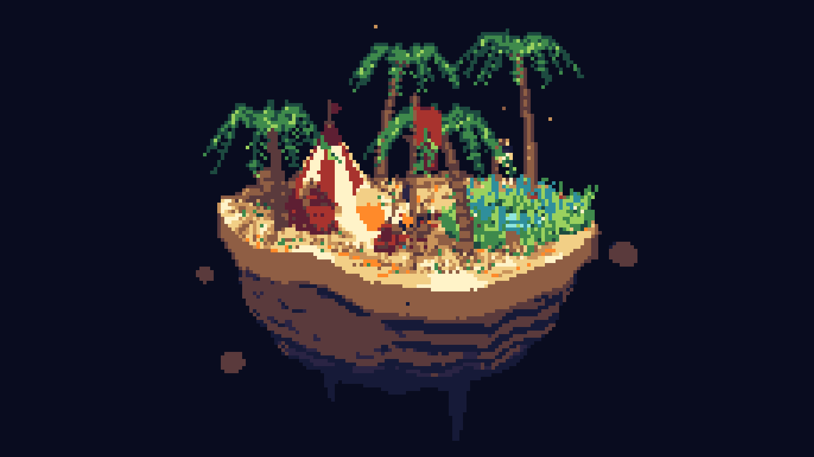
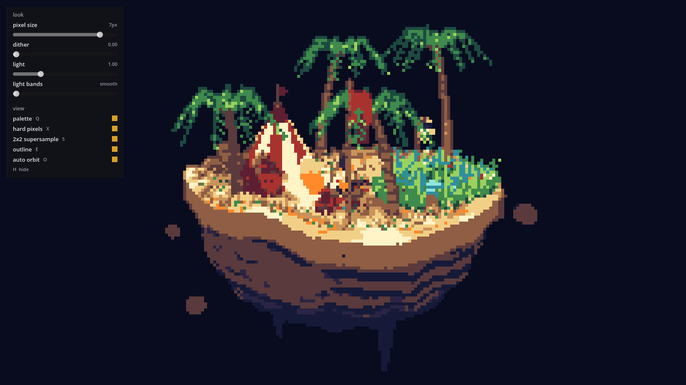

# Pixel Art Splats for Godot

Gaussian surfels drawn as pixel art, in Godot 4. A port of
[pixelart-gaussiansplat](https://github.com/cobanov/pixelart-gaussiansplat) (three.js + Spark), and a
companion to the [Unity package](https://github.com/yanhuifair/pixelart-gaussiansplat-unity) — same technique,
same 64-byte splat record, same kind of palette.



A surface becomes a cloud of flat shaded discs. Each disc carries its own normal, so it can be lit;
the whole cloud is drawn at twice the art resolution with the Gaussian falloff switched off, and a
fullscreen pass votes every 2×2 block of samples into one flat palette colour. Real 3D that reads as
pixel art: crisp silhouettes, ink outlines, a small palette, no soft splat mush.

147 769 surfels, 16 colours, no textures, two draw calls.

## Install

This repository **is** the addon, so the folder has to end up at `addons/pixel_art_splats/` — the
shaders include each other by that path.

```bash
cd your_project/addons
git clone https://github.com/yanhuifair/pixelart-gaussiansplat-godot.git pixel_art_splats
```

Or download the zip and drop the contents there. Then enable it: **Project → Project Settings →
Plugins → Pixel Art Splats**.

Requires Godot 4.7 (Forward+). Older 4.x should work; the shaders use nothing exotic beyond
`INSTANCE_CUSTOM` and `FRAGCOORD`.

## Try the demo

`demo/caravan.tscn` ships with the addon — a caravan camp at an oasis: striped tent, cooking fire,
palms, a pond — so there is nothing to set up:

1. Open the scene, press **F6** (run current scene) or make it the main scene and press F5.
2. Drag to orbit, scroll to zoom — it drifts on its own when left alone.

Opening the project from the command line instead? Godot builds its `class_name` cache in the editor,
so warm that once first; otherwise every script that names `SplatCloudNode` fails with *"Could not
find type"*:

```bash
godot --headless --path . --editor --quit
godot --path .
```

## In your own scene

1. Add a `SplatCloudNode` (a `Node3D`) and give it a `SplatCloud` resource.
2. Add a `PixelArtView` (a `Control`) as a sibling. It sizes itself to the window, creates its own
   camera inside a low-resolution `SubViewport`, and draws the pixel pass over everything.
3. Give the view a `PixelArtPalette`.

Cameras: the view owns one. Do not add your own `Camera3D` — the world must only ever be rendered at
the art resolution, which is what the view's SubViewport is for. If you need the camera elsewhere, ask
the view: `view.camera` is an `OrbitCamera` you can drive with `view.camera.orbit(relative)` and
`view.camera.zoom(direction)`.

## The look

All on `PixelArtView`:

| Field | What it does |
|---|---|
| `pixel_size` | Screen pixels per art pixel (1..8). Fixed to the screen: zooming changes what is in a pixel, never its size. |
| `supersample` | Draw at 2× the art resolution: four samples per art pixel, which the pass votes over. Off = one sample. |
| `crisp` | Hard-edged discs and nearest-sampled palette colours. Off = soft Gaussians, blended. |
| `outline` | A solid pixel next to the background takes a darker ink of its own colour. |
| `quantise` | Snap every pixel to the palette. Off shows the continuous colours. |
| `dither` | 4×4 ordered (Bayer) dithering between the two nearest palette colours. 0 = off. |
| `min_texels` | Grows tiny distant splats so surfaces do not fall apart. |
| `debug_raw` | Show the small splat render on its own, without the pixel pass. |

The panel the [browser viewer](https://splats.cobanov.dev/) puts over the picture ships as
`PixelArtHud`, in two forms:

- **While authoring:** the plugin puts it in a dock (bottom right). It follows the selected
  `PixelArtView`, or the first one in the open scene, and writes the scene as you drag.
- **While playing:** drop a `PixelArtHud` next to the view. It draws over the picture and takes the
  site's keys — **H** hides it, **Q** palette, **X** hard pixels, **S** 2×2 supersample, **E**
  outline, **O** auto orbit.

The demo carries the runtime one.



`SplatCloudNode` holds the cloud plus the live-lighting knobs — `exposure`, `bands` (flat cel steps),
`fog_start`, `fog_end`, `cull_backfaces`. They only affect splats that are not baked: meshes you bake
yourself, mostly. Baked clouds carry their own light, so those knobs do nothing to them.

## Data

A `SplatCloud` is a resource with a `PackedByteArray`: 64 bytes per surfel, solid ones first then
translucent light.

| Offset | Field |
|---|---|
| 0 | position, 3 floats |
| 12 | axis1, 3 floats — wide axes of the disc; their **length is the radius** |
| 24 | axis2, 3 floats |
| 36 | normal, 3 floats — the thin axis |
| 48 | colour, 3 floats — display space |
| 60 | flags, uint32 — emissive 1, two-sided 2, glow 4, baked 8, up-normal 16, sway 32, alpha in bits 8–15 |

This is byte-for-byte the layout the Unity package writes, so a scene baked there opens here
unchanged. The demo data came from the browser project instead: `tools/dio_to_bytes.py` expands one
of its `.dio` worlds into this layout (`public/models/caravan.dio` → 147 769 surfels), then the
converter writes the `.res`.

## Tools

Project → Tools → **Pixel Art Splats**:

- **convert .bytes to SplatCloud…** — takes a selected `.bytes` blob of surfels and writes a `.res`
  next to it. Headless too:

  ```bash
  godot --headless --path . --script res://addons/pixel_art_splats/editor/convert_bytes.gd \
        -- res://path/to/cloud.bytes res://path/to/cloud.res 0.0215
  ```

  The last argument is the splat spacing used by the bake, which the shader needs to grow small
  distant splats sensibly. Optional; 0 leaves it at the default.

- **bake selected meshes to SplatCloud…** — scatters surfels over the selected `MeshInstance3D`s by
  area, colour from the material's albedo, its texture and vertex colours. 18 000 splats for a sphere
  takes about 20 ms.

To bring a world over from the [browser project](https://github.com/cobanov/pixelart-gaussiansplat),
convert its `.dio` first, then run the same converter:

```bash
python3 addons/pixel_art_splats/tools/dio_to_bytes.py caravan.dio caravan.bytes
godot --headless --path . --script res://addons/pixel_art_splats/editor/convert_bytes.gd \
      -- res://demo/caravan.bytes res://demo/caravan.res 0.02
```

Both converters write compressed resources: a cloud is mostly float noise, so zstd takes about 40%
off and costs a few milliseconds to load.

## How it is put together

```
shaders/splat_common.gdshaderinc   the surfel vertex work and the per-splat light (shared)
shaders/splat.gdshader             solid discs: blended, depth written, alpha 1
shaders/splat_glow.gdshader        translucent light: blended, no depth write
shaders/pixel_art.gdshader         the pixel pass: coverage, palette vote, ink, haze, dither
splat_cloud.gd                     the Resource, and the MultiMesh buffer it builds
splat_cloud_node.gd                one cloud as two MultiMeshInstance3D (solid, then glow)
pixel_art_view.gd                  the SubViewport, the camera, the pass, the settings
pixel_art_hud.gd                   the settings panel, the same one the browser shows
palette.gd                         hex colours → shader uniforms
orbit_camera.gd                    drag / scroll / drift
splat_importer.gd                  .bytes blobs and mesh scattering
editor/convert_bytes.gd            headless converter
tools/dio_to_bytes.py              .dio (browser world) → this layout
plugin.cfg, plugin.gd              the editor plugin and its tool menu
demo/                              Caravan camp: the scene, its cloud, its palette
```

Three Godot things worth knowing if you change the shaders:

- A splat is one instanced quad. The MultiMesh instance transform carries the two wide axes in its
  basis (`m[0]`, `m[1]`) and the centre in `m[3]`, so the quad *is* the splat's footprint and the disc
  test happens on the quad's own `(u, v)`. Corners carry their real position, so depth is the depth
  of the surfel plane at that pixel. Nothing is stored in the vertex buffer.
- A solid splat **must write `ALPHA = 1.0`** or it ends up with alpha 0. In a transparent SubViewport
  `unshaded` does not write alpha at all, and the pixel pass reads coverage back out of it — with
  alpha stuck at zero every art pixel looks empty and you get the raw blurred splats instead of
  pixel art. Hence `blend_mix, depth_draw_always` on the solid shader.
- Colours stay in **display space** the whole way through, because that is the space the palette is
  authored in. The 3D viewport encodes what it writes to sRGB, so the splat shader writes
  `srgb_to_linear(colour)` and the pass reads exactly `colour` back — measured, exact to ±1/255. The
  canvas pass then writes display values straight out, since canvas output is not re-encoded. Godot
  has no built-in `srgb_to_linear()` for shaders, so the include carries the piecewise curve.

## Limits

- The pass covers the whole screen. Anything you want on top of it (2D UI) has to come after it in
  the tree, or live in a `CanvasLayer` above it.
- WorldEnvironment tonemapping and glow would break the palette exactness — leave them off.
- The addon folder must be named `pixel_art_splats`: shader includes and the demo's `.res` refer to
  it by absolute `res://` path.
- Not ported: particles (the camp's embers and smoke), skinned animation, automatic palettes from a
  model's colours, the original light-shaft data. The fire itself is baked geometry and halo, so it
  reads fine; what is missing is the movement above it.
- Converted clouds want `cull_backfaces` off: the browser never culls splats in a world, and a baked
  silhouette has surfaces facing every way.

## Credits

- [pixelart-gaussiansplat](https://github.com/cobanov/pixelart-gaussiansplat) by Mert Cobanov — the
  technique, and the shader and authoring logic this follows. MIT.
- [Unity package](https://github.com/yanhuifair/pixelart-gaussiansplat-unity) — the port this one matches.
- The idea of pixel-art splat dioramas came from [Silicon Jungle](https://x.com/JungleSilicon).

MIT.
